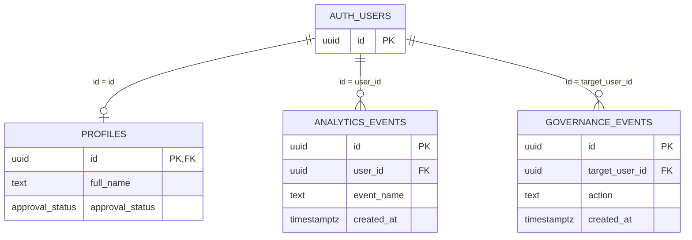

# Build the user review semantic layer from Supabase

This tutorial explains how we built the Sakura3 Wren MVP from a business question and the existing `sakura3Prod` PostgreSQL database. Follow the reasoning as well as the YAML: a useful semantic layer records **what a field means, where its evidence comes from, and how a query must combine that evidence**. So far we have only read the production database. The Wren files create no database objects.

The question is: **“Show users, including their submission date and approval date.”**

## 1. Find the evidence before writing MDL

Translate the question into concepts, then inspect the source tables and event values:

| Concept | Source | Why |
| --- | --- | --- |
| One user | `public.profiles`, keyed by `id` | One profile row is one report row. |
| Current state | `profiles.approval_status` | `unsubmitted` means not submitted; `pending` means awaiting review. The field stores state, not when it changed. |
| Submission time | First `analytics_events.created_at` where `event_name = 'profile_completed'` | This event records profile completion for the user. |
| Verifier approval time | First `governance_events.created_at` where `action = 'APPROVAL_GRANTED'` | You confirmed this action is recorded when the verifier approves the target user. |

The schema has no dedicated submission or approval timestamp column. The `approval_status` enum contains `unsubmitted`, `pending`, `approved`, `suspended`, and `rejected`; its current value cannot reconstruct a historical transition time.

To repeat the first discovery step yourself, inspect the relevant columns and count the candidate events:

```sql
SELECT table_name, column_name, data_type
FROM information_schema.columns
WHERE table_schema = 'public'
  AND table_name IN ('profiles', 'analytics_events', 'governance_events')
ORDER BY table_name, ordinal_position;

SELECT event_name, COUNT(*)
FROM public.analytics_events
GROUP BY event_name
ORDER BY event_name;

SELECT action, COUNT(*)
FROM public.governance_events
GROUP BY action
ORDER BY action;
```

The observed event totals were 29 `profile_completed` rows and 29 `APPROVAL_GRANTED` rows. Totals alone do not prove user coverage, which is why we ran the grouped join check below.

### Source database diagram



These are real foreign-key paths through Supabase `auth.users`: `profiles.id`, `analytics_events.user_id`, and `governance_events.target_user_id` identify the same user. We do not model `auth.users` because the report needs none of its columns. `governance_events` also has `actor_user_id`, the person performing an action. For this report, join on **`target_user_id`**, the person being approved. The diagram omits unrelated physical columns; the Wren models do too.

### Check whether the evidence covers users

Run this read-only PostgreSQL query to inspect the match rates:

```sql
WITH submissions AS (
  SELECT user_id, MIN(created_at) AS submitted_at
  FROM public.analytics_events
  WHERE event_name = 'profile_completed'
  GROUP BY user_id
), approvals AS (
  SELECT target_user_id AS user_id, MIN(created_at) AS approved_at
  FROM public.governance_events
  WHERE action = 'APPROVAL_GRANTED'
  GROUP BY target_user_id
)
SELECT p.approval_status,
       COUNT(*) AS users,
       COUNT(s.submitted_at) AS with_submission_date,
       COUNT(a.approved_at) AS with_approval_date
FROM public.profiles p
LEFT JOIN submissions s ON s.user_id = p.id
LEFT JOIN approvals a ON a.user_id = p.id
GROUP BY p.approval_status
ORDER BY p.approval_status;
```

Our read-only inspection on **2026-11-15** found:

| Current status | Users | With submission date | With approval date |
| --- | ---: | ---: | ---: |
| approved | 28 | 28 | 27 |
| pending | 1 | 1 | 0 |
| suspended | 2 | 0 | 2 |
| unsubmitted | 8 | 0 | 0 |

These counts are a snapshot, not a permanent invariant. One currently approved user lacks a matching approval event; two suspended users lack a submission event. Where both dates existed, none had approval before submission. Missing events must remain `NULL` rather than being replaced with profile creation or update time. We chose the **earliest** event using `MIN`; a later requirement for reapproval or resubmission would require a different rule.

## 2. Map each source table to a small Wren model

[wren_project.yml](../wren_project.yml) names the project, sets `data_source: postgres`, and defines the Wren query namespace `wren.public`. The `public` in each model's `table_reference.schema` is different: it is the physical PostgreSQL schema. See [Wren's MDL reference](https://docs.getwren.ai/oss/reference/mdl) for this distinction.

To create this layout from an empty directory, install the pinned dependency and make one directory per model and view:

```bash
python3 -m venv .venv
.venv/bin/pip install -r requirements.txt
mkdir -p models/{profiles,profile_events,governance_events} \
  views/users_with_review_dates knowledge/rules
```

On the machine used for this project, `python3 -m venv` lacked `ensurepip`. We instead ran `python3 -m venv --without-pip .venv`, downloaded the official `get-pip.py` from `https://bootstrap.pypa.io/get-pip.py`, ran it with `.venv/bin/python`, then installed `requirements.txt`. The checked-in project files are the result; `.venv/` is ignored by Git.

The project file begins with `schema_version: 5`, `name: sakura_users_mvp`, and `data_source: postgres`. We wrote each `metadata.yml` by hand so its source mapping and column choices could be reviewed. Wren then compiled those files with `context build`.

We built three models:

| Wren model | Physical table | Exposed columns | Purpose |
| --- | --- | --- | --- |
| [profiles](../models/profiles/metadata.yml) | `public.profiles` | `id`, `full_name`, `approval_status` | One row per user and current state. |
| [profile_events](../models/profile_events/metadata.yml) | `public.analytics_events` | `id`, `user_id`, `event_name`, `created_at` | Find submission events. |
| [governance_events](../models/governance_events/metadata.yml) | `public.governance_events` | `id`, `target_user_id`, `action`, `created_at` | Find verifier approval events. |

Read a model in this order: `name` is what Wren queries call it; `table_reference` locates the source; `primary_key` states the row grain; `columns` decides what Wren exposes. For example:

```yaml
name: profiles
table_reference:
  schema: public
  table: profiles
primary_key: id
columns:
  - name: id
    type: VARCHAR
    is_primary_key: true
    not_null: true
  - name: full_name
    type: VARCHAR
  - name: approval_status
    type: VARCHAR
```

The actual file also has a description. We mapped source UUID IDs to Wren `VARCHAR` and source `timestamptz` to Wren `TIMESTAMP`. Compilation and offline planning passed; a live Wren query is still needed to confirm runtime type behavior. We omitted email, event properties, and governance metadata because the question does not need them. This keeps the agent-facing schema focused. Database permissions remain the stronger access boundary.

The two event models repeat the same mapping pattern. In `profile_events`, `table_reference.table: analytics_events`, `user_id` identifies the subject, and `event_name` lets the view select only `profile_completed`. In `governance_events`, `table_reference.table: governance_events`, `target_user_id` identifies the subject, and `action` lets the view select only `APPROVAL_GRANTED`. Both expose `created_at` for the date calculation. This is how a physical event log becomes a small, readable semantic input.

## 3. Combine evidence in a Wren view

The event tables can contain many rows per user. Joining them raw to `profiles` could multiply users. The [users_with_review_dates view](../views/users_with_review_dates/metadata.yml) filters and groups each event type **before** joining it to profiles:

```sql
SELECT p.id AS user_id,
       p.full_name,
       p.approval_status,
       s.submitted_at,
       a.approved_at
FROM wren.public.profiles p
LEFT JOIN (
  SELECT user_id, MIN(created_at) AS submitted_at
  FROM wren.public.profile_events
  WHERE event_name = 'profile_completed'
  GROUP BY user_id
) s ON p.id = s.user_id
LEFT JOIN (
  SELECT target_user_id, MIN(created_at) AS approved_at
  FROM wren.public.governance_events
  WHERE action = 'APPROVAL_GRANTED'
  GROUP BY target_user_id
) a ON p.id = a.target_user_id
```

The filters encode the chosen business events. `MIN` means first occurrence. `LEFT JOIN` keeps users with missing events and returns a null date for them. The view references Wren models, while those models reference physical tables. This view lives in the Wren project; it is not a PostgreSQL `CREATE VIEW`.

We did not add `relationships.yml`: the MVP has one report shape with two event aggregates, so explicit joins in the view are easier to inspect. Reusable MDL relationships become useful when several models or calculated fields need the same join paths. [Wren's modeling guide](https://docs.getwren.ai/oss/guides/model) describes that progression.

## 4. Explain the business meaning in `knowledge/`

The [user review dates rule](../knowledge/rules/user_review_dates.md) says what `pending` and `unsubmitted` mean, why the first event is used, how to treat missing dates, and which view answers this question. The source schema cannot explain those decisions to an AI client.

To build that file, write one Markdown topic under `knowledge/rules/` and state the business choices explicitly. For example:

```markdown
- `submitted_at` is the earliest `profile_completed` event for the user.
- `approved_at` is the earliest `APPROVAL_GRANTED` event targeting the user.
- A missing matching event produces a null date.
- For this question, query `users_with_review_dates`.
```

Each statement answers a likely agent ambiguity: which event, which user in the governance record, what to do with missing history, and which object is canonical. We added a separate sentence about `approval_status` because otherwise an agent might mistake the current state for a historical timestamp.

| Artifact | Responsibility |
| --- | --- |
| Models | Map and describe queryable fields from source tables. |
| View | Enforce the event filters, first-date calculation, joins, and output shape in SQL. |
| `knowledge/rules/` | Guide an AI client in choosing and interpreting those objects. |

Knowledge prose is **not** compiled into the SQL engine. An agent can retrieve the rule, but Wren does not turn its sentences into mandatory filters. That is why the date calculation belongs in the view. [Wren's knowledge guide](https://docs.getwren.ai/oss/guides/refine) explains rules and confirmed question-to-SQL examples.

## 5. Reproduce the checks we completed

The [requirements file](../requirements.txt) pins `wrenai[postgres,mcp]==0.18.0`. After installing it in `.venv`, run from the project root:

```bash
.venv/bin/wren context build
.venv/bin/wren context validate
.venv/bin/wren context instructions
.venv/bin/wren dry-plan --datasource postgres \
  --sql "SELECT user_id, full_name, approval_status, submitted_at, approved_at FROM users_with_review_dates LIMIT 5"
```

- `context build` compiled **3 models and 1 view** into ignored `target/mdl.json`.
- `context validate` reported a valid project with zero MDL relationships.
- `context instructions` printed the `knowledge/rules/` text.
- `dry-plan` expanded a query against the three physical `public` tables without connecting. The `--datasource postgres` flag was needed because no profile is bound yet.

These checks do **not** prove that a live Wren query returns the expected rows. We separately checked the date logic with the read-only PostgreSQL query in section 1. `wren memory index` reports zero confirmed pairs in `knowledge/sql/`, which is expected; add a question-to-SQL example only after verifying a live answer.

## 6. Next steps, not yet completed

The checked-in [.env.example](../.env.example) and [connection.example.yml](../connection.example.yml) show the connection fields. This workspace cannot reach Sakura3's IPv6-only direct database host, so use the **session pooler** host, port, and username shown in the Supabase project's **Connect** dialog. Put real credentials in ignored `.env`. A local test can use the project database password; use a SELECT-only database role before exposing MCP beyond this machine. Inspect the installed connector with `.venv/bin/wren docs connection-info postgres`, then add and bind a profile. Run a live modeled query and compare its row count and dates with the PostgreSQL check above. Finally run `wren serve mcp` and inspect the schema, knowledge, and query tools from an MCP client. The [connection guide](https://docs.getwren.ai/oss/guides/connect) and [MCP guide](https://docs.getwren.ai/oss/guides/mcp) cover those commands.

Before extending the MVP, a reader should be able to explain: why current status cannot provide a date; why `target_user_id` is the correct governance field; why aggregation happens before joins; why missing events yield nulls; and why the SQL rule lives in a view while interpretation lives in `knowledge/`.
