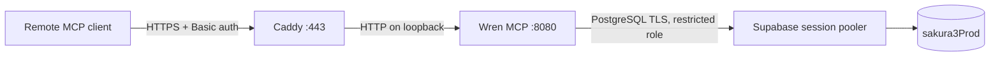

# Deploy this Wren MCP for remote clients

This guide continues the [semantic-layer tutorial](building-the-user-review-semantic-layer.md). The endpoint is `https://konteks.veryresto.com/mcp` and speaks MCP Streamable HTTP. A client must send HTTP Basic authentication with username `wren` and the password stored on this server in `/etc/fery-wren/client.env`.



## 1. Create the restricted database login

The Wren MCP `run_sql` tool accepts client SQL. Wren's model definitions hide unrelated columns from its semantic schema, but database privileges are the final boundary. The original `.env` contains a `postgres` login, so the public service uses a separate login named `wren_sakura_reader`.

Run `sudo .venv/bin/python scripts/provision_reader.py` once from the project root. The [provisioning script](../scripts/provision_reader.py) creates a login with no database-creation, role-creation, or RLS-bypass capability; grants `USAGE` on `public`; and grants `SELECT` only on the model's columns in `profiles`, `analytics_events`, and `governance_events`. It adds RLS policies that reveal only `profile_completed` analytics events and `APPROVAL_GRANTED` governance events. No application rows are changed.

Two existing event SELECT policies originally applied to every PostgreSQL role but depended on Supabase `auth.uid()` and `user_roles`. PostgreSQL attempted those checks for the new login. The script scopes those two policies to Supabase's `authenticated` role, keeping the signed-in application's access path while letting the new login use its own policies. This is a production policy change; review it before reusing the script on another database.

The script generates a password and saves its connection values in `/etc/fery-wren/wren.env` with root-only access. It refuses to rotate an existing credential. The service uses the pooler username `wren_sakura_reader.cycloiewvrajoeosahtd`. The role was checked with a read-only transaction: it saw 39 profiles, 29 relevant analytics events, and 29 relevant governance events. It had no privilege to select `profiles.email`, insert profiles, or read `user_roles`.

## 2. Compile Wren and add the connection profile

```bash
.venv/bin/pip install -r requirements.txt
.venv/bin/wren context build
.venv/bin/wren context validate
.venv/bin/wren profile add sakura_mcp_reader \
  --from-file deploy/connection.mcp.yml --no-validate
```

The profile file stores `${WREN_DB_*}` references, not passwords. systemd loads the actual values from `/etc/fery-wren/wren.env` when the service starts. `--no-validate` is used during profile creation because those variables are available to the service, not the interactive shell. `wren_project.yml` is not pinned to this server-specific profile; the service passes `--profile sakura_mcp_reader` explicitly. Rebuild and restart the service after changing models or views because Wren serves the compiled `target/mdl.json`.

## 3. Run Wren only on loopback

Install [the service unit](../deploy/fery-wren-mcp.service) into `/etc/systemd/system/fery-wren-mcp.service`, then start it:

```bash
sudo install -m 644 deploy/fery-wren-mcp.service /etc/systemd/system/fery-wren-mcp.service
sudo systemctl daemon-reload
sudo systemctl enable --now fery-wren-mcp
```

The service command is equivalent to:

```bash
.venv/bin/wren serve mcp --transport http \
  --host 127.0.0.1 --port 8080 \
  --profile sakura_mcp_reader --quiet
```

Loopback binding means a remote client cannot bypass Caddy. We did not pass `--allow-write`, so Wren's `store_query` tool is absent. The database login has no write grants on application tables.

## 4. Put Caddy in front

Install Caddy, generate authentication credentials, and copy [deploy/Caddyfile](../deploy/Caddyfile) and [the systemd override](../deploy/caddy.service.override.conf):

```bash
sudo apt-get install caddy
sudo .venv/bin/python scripts/generate_mcp_client_auth.py
sudo install -m 644 deploy/Caddyfile /etc/caddy/Caddyfile
sudo mkdir -p /etc/systemd/system/caddy.service.d
sudo install -m 644 deploy/caddy.service.override.conf \
  /etc/systemd/system/caddy.service.d/override.conf
sudo systemctl daemon-reload
sudo systemctl restart caddy
```

The script writes a bcrypt hash to `/etc/fery-wren/caddy.env` and the client password to `/etc/fery-wren/client.env`; both files are root-only. It refuses to rotate an existing credential. This server uses Ubuntu's Caddy 2.6 package, whose directive is `basicauth`; newer releases call it `basic_auth`.

Caddy obtains and renews the HTTPS certificate for the domain. It authenticates every request, strips the Basic Authorization header before proxying, and sends Wren a loopback `Host` header. The Host override is needed because the installed Wren HTTP server rejected the public domain as an upstream Host header (`421 Invalid Host header`). The upstream remains private on `127.0.0.1:8080`.

DNS for `konteks.veryresto.com` resolves to this server's public IP. Caddy obtained a trusted certificate through the public TLS challenge. An unauthenticated `GET /mcp` returns `401`; a browser GET after authentication may return `406` because MCP expects its protocol headers.

## 5. Verify from an MCP client

Use the URL `https://konteks.veryresto.com/mcp`. Configure HTTP Basic authentication with username `wren` and the password from `/etc/fery-wren/client.env`. Read it only in your own terminal with `sudo cat /etc/fery-wren/client.env`; never put it in Git or a shared screenshot. The client must support custom HTTP authentication headers. Some harnesses have a dedicated bearer-token option but no Basic option, so check the client's MCP HTTP settings before registering it.

The authenticated smoke test initialized an MCP session over HTTPS, listed tools, retrieved `get_instructions`, and called `run_sql` with:

```sql
SELECT approval_status,
       COUNT(*) AS users,
       COUNT(submitted_at) AS submitted,
       COUNT(approved_at) AS approved
FROM users_with_review_dates
GROUP BY approval_status
ORDER BY approval_status;
```

It returned the same 39 users and date coverage as the source-database checks. Use bare Wren model and view names in SQL with this Wren 0.18.0 setup. The [MDL reference](https://docs.getwren.ai/oss/reference/mdl) shows fully qualified examples, but this installed PostgreSQL execution path left `wren.public.*` in the generated SQL and PostgreSQL rejected it as a cross-database reference.

To inspect the running services, use `systemctl status fery-wren-mcp caddy` and `sudo journalctl -u fery-wren-mcp -u caddy -n 50 --no-pager`. To deploy a semantic-layer change, run `.venv/bin/wren context build && .venv/bin/wren context validate` and restart `fery-wren-mcp`.
